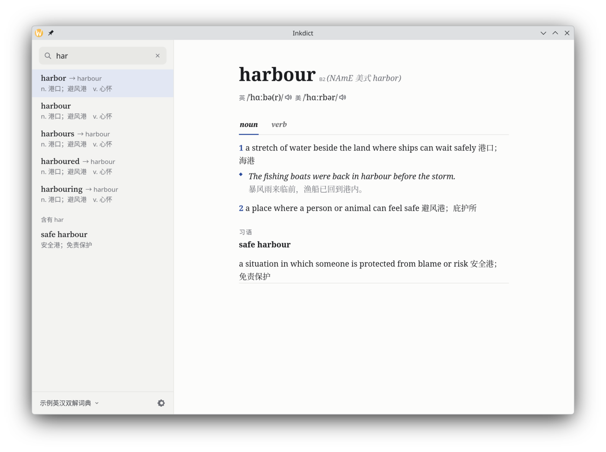

# Inkdict

Inkdict is an open format for dictionaries and a fast, offline dictionary app that reads it.

A dictionary is one `.inkdict` file. It carries its entries, a lookup index, and its own **theme**, so the dictionary — not the app — decides how its entries look. The format works for any language: lookup keys, fonts and writing direction follow each pack's declared languages.



[中文说明](README.zh-CN.md)

## What is here

| | |
| --- | --- |
| [`spec/`](spec/) | The protocol, version 1 (frozen): entry content, type registry, themes ([`v1.md`](spec/v1.md)) and the pack format ([`pack-v1.md`](spec/pack-v1.md)), with a complete [sample dictionary](spec/samples/en-zh/) |
| [`docs/making-a-dictionary.md`](docs/making-a-dictionary.md) | A step-by-step guide to making your own dictionary |
| `inkdict` | A command-line tool: `inkdict pack` builds a dictionary from its source files; `words`, `show`, `render`, `themes` and `info` inspect one |
| Inkdict desktop | The app, for Linux, Windows and macOS: instant word list as you type, entries with tabs, pronunciation, cross-references, history, several dictionaries, a choice among a dictionary's own themes, light and dark |

Inkdict ships no dictionary content of its own apart from the small sample. You bring dictionaries you have the right to use.

## Getting started

1. Download the app and the `inkdict` tool for your system from the [releases page](https://github.com/ZeyuZuo/Inkdict/releases), together with `sample-en-zh.inkdict`.
2. Put the `.inkdict` file into the app's dictionary folder (on Linux `~/.local/share/win.zeyuz.inkdict/dictionaries`; the settings show it and have a button to open it), or click the gear icon at the bottom of the sidebar, choose **添加词典…** (Add dictionary) and pick the file, which copies it there. (The app's interface is in Chinese for now; an English interface is planned.)
   On macOS the app is not notarized by Apple: the first time, open it, then allow it under System Settings → Privacy & Security → **Open Anyway**.
3. To make a dictionary of your own, follow [docs/making-a-dictionary.md](docs/making-a-dictionary.md).

## Building from source

You need Rust 1.95 (`rust-toolchain.toml` selects it) and, for the desktop app, Node.js 20.19 or newer plus the [Tauri 2 prerequisites](https://v2.tauri.app/start/prerequisites/) of your system (on Linux: WebKitGTK 4.1).

```bash
cargo build --release -p inkdict-cli       # target/release/inkdict
cargo test                                 # the Rust crates

cd apps/desktop
npm install
npm run tauri build                        # installers under target/release/bundle/
npm run check && npm test                  # the UI
```

The desktop app's development setup is described in [`apps/desktop/README.md`](apps/desktop/README.md).

## Repository layout

```text
spec/                  the protocol (CC BY 4.0) and the sample dictionary
docs/                  guide, architecture, roadmap
crates/
  inkdict-core/        reads packs: word list, entries, links, resources, themes and render trees
  inkdict-pack/        builds packs from a source directory
  inkdict-html/        turns render trees into HTML and theme CSS (desktop app)
  inkdict-app/         the desktop app's logic, independent of Tauri: dictionaries, settings, commands
  inkdict-cli/         the inkdict command-line tool
apps/
  desktop/             the desktop app (Tauri 2, Svelte 5)
  android/             planned
scripts/               maintainer tools that compare against the Oxford data in the separate OxDic repository
```

How the parts fit together: [`docs/architecture.md`](docs/architecture.md). What comes next: [`docs/roadmap.md`](docs/roadmap.md).

## Tests

`cargo test` builds the sample dictionary with `inkdict pack` and tests reading, the word list, rendering, the CLI and the app's logic against it; no other data is needed. Maintainers also check the core against a full Oxford dictionary and a Python reference implementation; that data is private (it lives in the OxDic repository), and those tests skip without it.

## License

- Code: MIT or Apache-2.0, at your option ([`LICENSE-MIT`](LICENSE-MIT), [`LICENSE-APACHE`](LICENSE-APACHE)).
- The protocol documents and the sample dictionary in `spec/`: CC BY 4.0 ([`spec/LICENSE`](spec/LICENSE)). Implementing readers, packers or dictionaries that follow the protocol needs no further permission.
